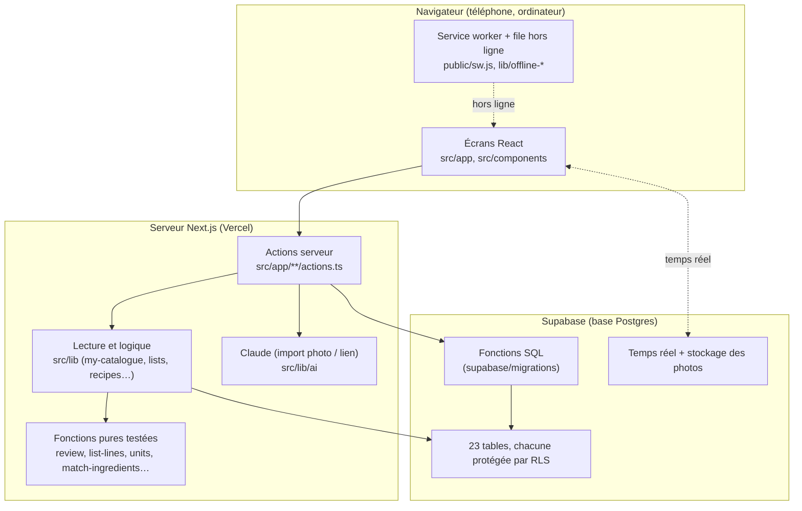

# Architecture d'Olva (vue d'ensemble)

Une page pour savoir où vit chaque chose. Le « quoi » fonctionnel est dans `SPEC.md` ;
ici, c'est le « où » et le « pourquoi ».

## Les trois étages

- **Navigateur** : l'affichage, les formulaires, le mode courses hors ligne.
- **Serveur Next.js** : il lit la base, appelle Claude (la clé ne quitte jamais le serveur) et calcule.
- **Supabase** : les données, les règles d'accès, et quelques opérations faites d'un seul bloc.

## Les grandes familles de tables

| Famille           | Tables                                                                                               |
| ----------------- | ---------------------------------------------------------------------------------------------------- |
| Catalogue         | `items`, `aisles`, `units`, `unit_conversions`, `item_aliases`, `my_item_aliases`, `item_overrides`  |
| Recettes          | `recipes`, `recipe_ingredients`, `collections`, `recipe_collections`, `recipe_imports`               |
| Listes et courses | `shopping_lists`, `shopping_list_recipes`, `shopping_list_items`, `prelist_items`, `carryover_items` |
| Partage           | `recipe_shares`, `library_shares`, `list_shares`, `auto_list_shares`, `share_links`                  |
| Compte            | `profiles`                                                                                           |

## Ce qui est en SQL, et pourquoi

Le SQL ne sert qu'à deux choses :

1. **La sécurité** : les fonctions `private.*` (`owns_recipe`, `can_edit_list`…) répondent à
   « ai-je le droit ? » pour les règles RLS. Elles vivent dans la base pour qu'aucun écran ne
   puisse les contourner.
2. **Les opérations « tout ou rien »** : `save_recipe`, `save_review`, `finalize_list`,
   `finish_shopping`, `copy_recipe`… Elles écrivent plusieurs tables à la fois, et soit tout
   réussit, soit rien ne change.

Tout le reste (calculs de portions, regroupement, conversions, rattachement des ingrédients)
est en TypeScript, dans des **fonctions pures** testées avec Vitest.

## « Mon catalogue » : une seule porte d'entrée (décision 061)

Ce que l'app sait d'un article vient de six sources : les articles communs et les miens, mes
personnalisations, les conversions communes et les miennes, les synonymes communs et les miens.
Tout est lu et combiné par **`src/lib/my-catalogue.ts`**, et nulle part ailleurs. Mes valeurs
passent toujours avant celles du catalogue.

## Deux chemins à connaître

**Import d'une recette (photo ou lien)**
`recettes/import/actions.ts` → `loadMyCatalogue` → Claude (`lib/ai/extract-recipe`, avec le
catalogue dans le prompt) → `resolveItem` (mes synonymes, puis le choix de Claude, puis le nom)
→ `convertToItemUnit` (poids moyens) → brouillon à l'écran → `saveRecipe` (et apprentissage de
mes corrections).

**Liste de courses**
Étape 1, les recettes (`set_list_recipes`) → étape 2, la revue (`getReview` →
`loadItemsDetails` → `computeReview`, puis `save_review`) → étape 3, la pré-liste et les ajouts
(`save_extras`) → la liste prête (`finalize_list`) → les courses en temps réel
(`set_line_checked`), avec la file hors ligne → la fin et le report (`finish_shopping`).
